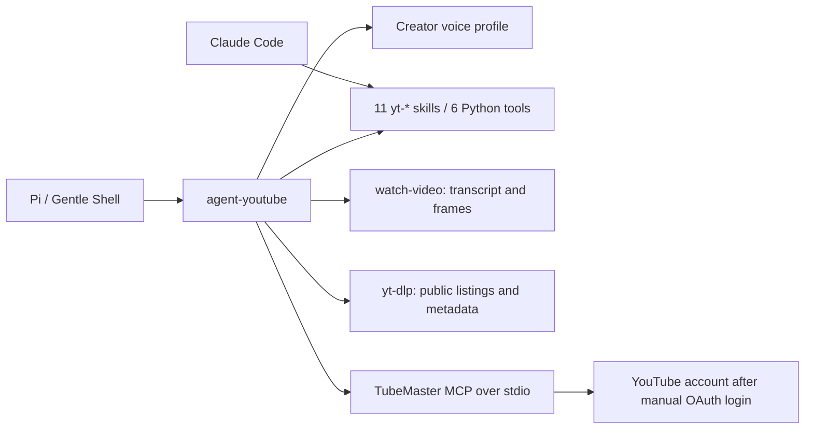
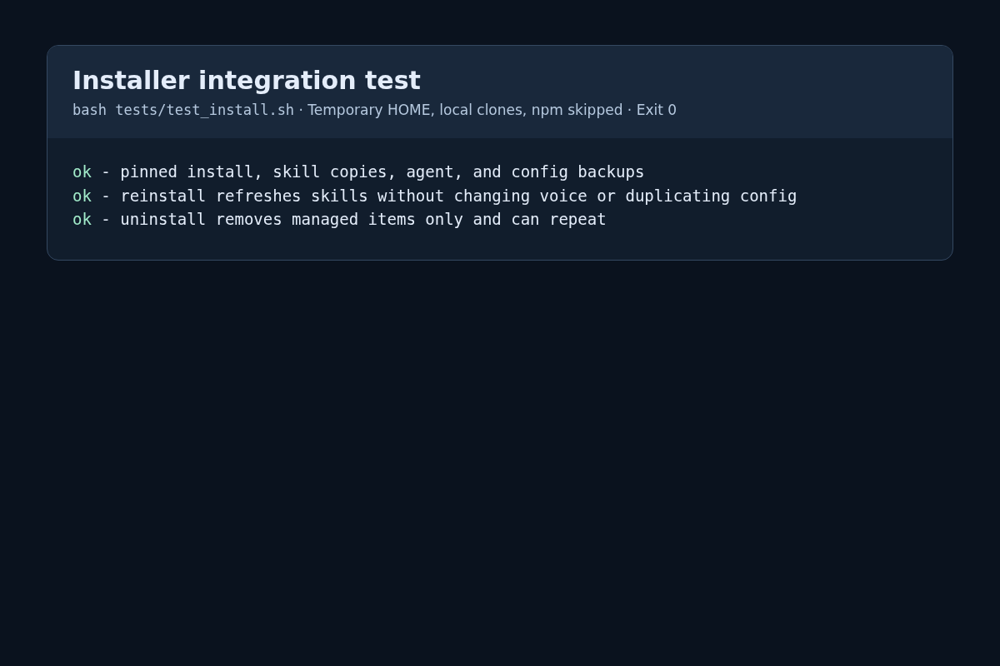
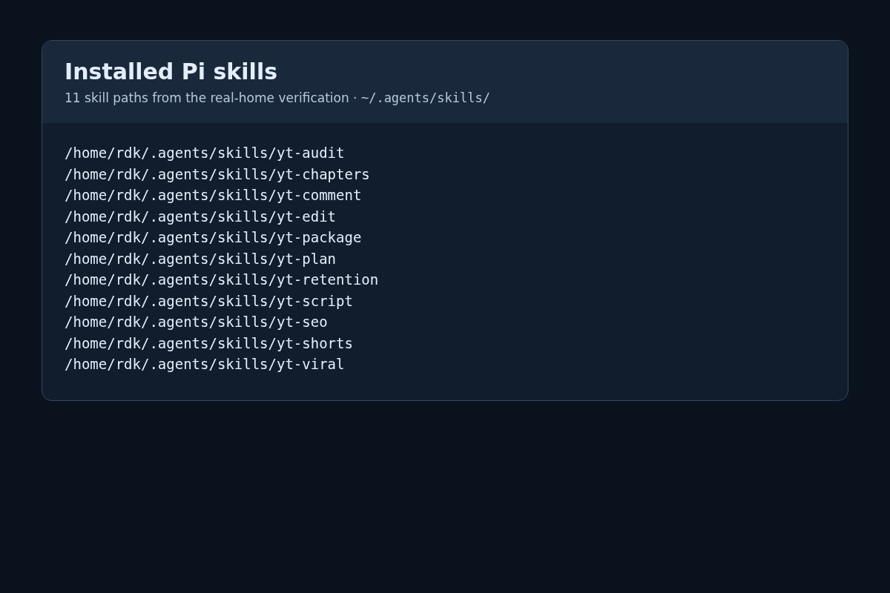

# Agent-Youtube

Agent-Youtube is a Gentle Shell subagent for Pi. It drafts and reviews YouTube scripts, titles, chapters, and other channel content. It bundles the 11 `yt-*` skills and six Python tools from `youtube-agent-skill` with the TubeMaster MCP integration. For video evidence and public listings it reuses `watch-video` and `yt-dlp` from your setup.

## Quick install

You need Bash, Git, Python 3, Node.js 20.9 or newer, and npm. To invoke the subagent, use Pi with Gentle Shell and access to the configured model. For video analysis, have `watch-video` and its `video-watcher` skill installed; `yt-dlp` is used for public listings and metadata. The installer does not install those video tools or either host application.

```bash
git clone https://github.com/RamonsDka/agent-youtube ~/p/agent-youtube && cd ~/p/agent-youtube && bash install.sh
```

Fill in `~/.claude/youtube/voice.md` with your audience, voice, and claims policy. Start a new Pi session and check that `agent-youtube` appears in the subagent list. Drafting and the local Python checks do not need Google OAuth.

### Connect TubeMaster for authenticated operations

Follow [TubeMaster's getting-started guide at the pinned revision](https://github.com/Gentleman-Programming/tubemaster/blob/a8497dcd50630c701c5dae5e5e17dfcc9e6819e9/docs/getting-started.md) to set up Google OAuth and create `vendor/tubemaster/.env.local` locally. Then sign in yourself:

```bash
cd ~/p/agent-youtube/vendor/tubemaster
npm run cli:video-metadata -- auth login
npm run cli:video-metadata -- auth whoami
```

The installer registers the MCP server without signing in. The server can list its tools before login; that list does not verify account or channel access. Use the upstream guide to select the expected write channel before proposing a channel change.

## Usage

In Pi, ask the main agent to delegate a request by name. For example:

> Delegate to `agent-youtube`: score five opening hooks for a video about using AI coding agents for 30 days. Then lint a title and thumbnail pair. Draft only.

> Delegate to `agent-youtube`: use this recording to draft timestamped chapters. Cite the timestamps and tell me if you only had the transcript.

You can also run the bundled Python tools directly. These examples use the default Pi skill directory; the same tools are in the Claude Code copies.

```bash
(cd "$HOME/.agents/skills/yt-script" && \
  python3 hookscore.py --hook "Before you let an agent touch your repo, here is what 30 days of it did to mine.")

(cd "$HOME/.agents/skills/yt-package" && \
  python3 title.py --title "I Let AI Agents Write Every Line for 30 Days" --thumb "HOW BAD?")
```

The agent reads the relevant `SKILL.md` before acting. The [routing table](agents/agent-youtube.md) lists all 11 skills and their tools.

## Architecture



Claude Code gets its own copies of the skills; the subagent and MCP registration are installed in Gentle Shell.

## What install changes

| Default location | Change |
| --- | --- |
| `~/p/agent-youtube/vendor/` | Checks out the two pinned upstream repos at detached commits and runs `npm install` in `vendor/tubemaster/`. `vendor/` is gitignored. |
| `~/.agents/skills/` and `~/.claude/skills/` | Copies all 11 `yt-*` skills to both locations. Reinstall replaces the matching skill directories, so save local edits before installing. |
| `~/.claude/youtube/voice.md` | Copies the template only if the path does not already exist. |
| `~/.gentle-shell/agent/agents/agent-youtube.md` | Installs the subagent definition, replacing any file at that path. |
| `~/.gentle-shell/agent/mcp.json` | Adds the `tubemaster` stdio entry, which runs `npm run mcp:video-metadata` from the TubeMaster checkout. |
| `~/.gentle-shell/agent/subagents.json` | Adds `cpamc/deeprelay/deepseek-v4.1-flash` with `high` effort for `agent-youtube`. |

Before rewriting an existing JSON config, the script saves a timestamped `<name>.json.bak.<UTC timestamp>` beside it. Unrelated JSON entries are preserved. Matching entries are left alone on reinstall; conflicting entries under the same names cause the installer to stop rather than overwrite them. Run `bash install.sh --help` for destination overrides.

### Uninstall

```bash
cd ~/p/agent-youtube
bash uninstall.sh
```

Uninstall removes matching JSON entries and backs up the configs it changes. It removes the installed skills and agent definition only if they still match the source copies. It keeps the voice profile, Git checkouts, backups, unrelated entries, and modified copies. Use the same path overrides as the install, if any.

## Safety rules

The agent must show the proposed change, target account and channel, and affected items before asking for explicit confirmation. That rule covers uploads (even private ones), publishing, metadata changes, scheduling, replies, and other channel mutations. If any detail changes, the agent must ask again. A tool confirmation token does not count as user approval. The agent is instructed to keep TubeMaster's channel, preview, and confirmation checks in place.

The agent must cite metric sources, label estimates, and say when data is missing. It must not invent numbers, read credentials, or use cookies or login with `yt-dlp`. Hook and title scores are local heuristics, not YouTube analytics.

## Screenshots

These terminal-style captures were rendered from actual results. The demo did not publish anything or test authenticated channel operations.

| Capture | Evidence |
| --- | --- |
| [Hook score](docs/assets/hookscore.png) | `hookscore.py` rated the selected demo hook 67 (`WORKABLE`). |
| [Title lint](docs/assets/title.png) | `title.py` rated the demo pairing 98/100 and warned about mobile truncation. |
| [Installer test](docs/assets/install-test.png) | Three passing checks in a temporary home, with npm skipped. |
| [Subagent demo](docs/assets/demo.png) | Demo excerpt with the first pass, revision, and selected pairing. |
| [Installed skills](docs/assets/skills.png) | All 11 paths in the Pi skill directory. |







## Testing

Provide local Git clones containing the pinned upstream commits and run from the project checkout:

```bash
YT_SKILL_REPO=/path/to/youtube-agent-skill \
TUBEMASTER_REPO=/path/to/tubemaster \
bash tests/test_install.sh
```

The test creates a temporary `HOME` and vendor directory and skips `npm install`. It verifies pinned checkouts, both sets of skills, the agent and config backups, reinstall behavior, and repeatable uninstall. See the [methodology](docs/methodology.md) for what was checked separately in the real install and how to regenerate the screenshots.

## Credits and license

- Jake Schincariol's [youtube-agent-skill](https://github.com/jakeschincariol/youtube-agent-skill), MIT, pinned to [`a2feb2104981a375ffd4f87ee04f4f5344ac43c6`](https://github.com/jakeschincariol/youtube-agent-skill/tree/a2feb2104981a375ffd4f87ee04f4f5344ac43c6).
- Gentleman Programming's [TubeMaster](https://github.com/Gentleman-Programming/tubemaster), MIT, pinned to [`a8497dcd50630c701c5dae5e5e17dfcc9e6819e9`](https://github.com/Gentleman-Programming/tubemaster/tree/a8497dcd50630c701c5dae5e5e17dfcc9e6819e9).

Agent-Youtube is released under the [MIT License](LICENSE). The upstream checkouts retain their own licenses and notices.
