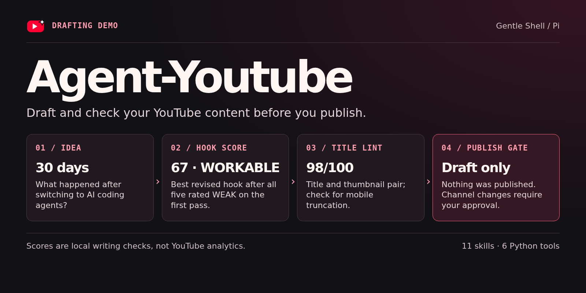
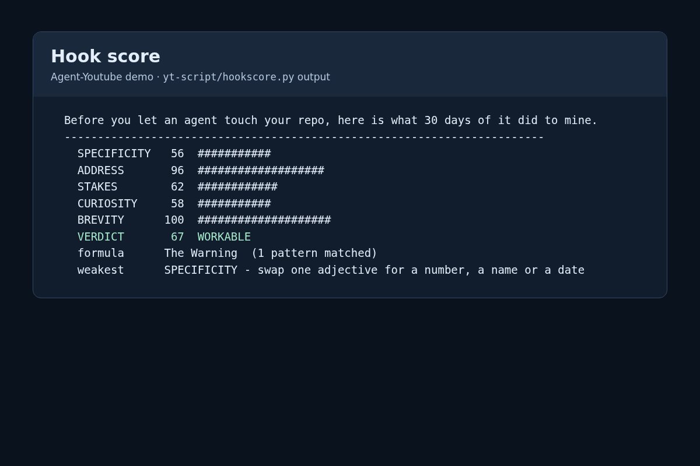
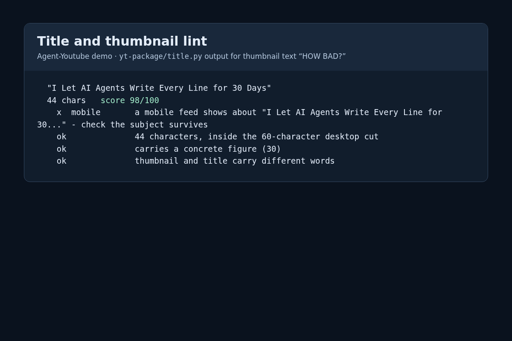
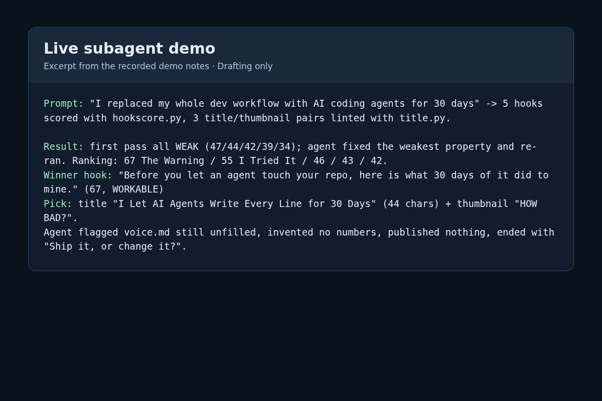
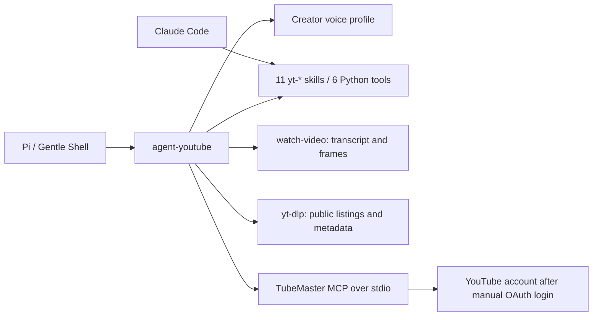

<p align="center">
  <picture>
    <source media="(prefers-color-scheme: dark)" srcset="docs/brand/agent-youtube-logo-white.svg">
    
  </picture>
</p>

<p align="center">
  
</p>

<h1 align="center">Agent-Youtube</h1>

<p align="center"><b>Draft and check your YouTube content before you publish.</b></p>

<p align="center">
  A Gentle Shell subagent for Pi that drafts scripts, checks titles and thumbnails, and builds chapters from recordings. It bundles the youtube-agent-skill pack and registers TubeMaster for authenticated channel operations.
</p>

<p align="center">
  <a href="#license"></a>
  <a href="#the-eleven-skills"></a>
  <a href="#tubemaster-oauth"></a>
  
  
  
  <a href="docs/methodology.md#real-installation-and-demo"></a>
</p>

<p align="center">
  <a href="#getting-started">Install</a> ·
  <a href="docs/methodology.md">Methodology</a> ·
  <a href="https://github.com/jakeschincariol/youtube-agent-skill">youtube-agent-skill upstream</a> ·
  <a href="https://github.com/Gentleman-Programming/tubemaster">TubeMaster upstream</a>
</p>

<p align="center">
  
  <br>
  <sub>The drafting demo, illustrated with its recorded hook and title scores. No authenticated channel operations were tested.</sub>
</p>

> [!NOTE]
> Agent-Youtube requires your explicit confirmation before it publishes, uploads (even privately), or makes any other change to a channel. Drafting and local checks don't need Google OAuth.

<p align="center">
  <a href="#what-it-does">What it does</a> ·
  <a href="#the-eleven-skills">The eleven skills</a> ·
  <a href="#how-it-works">How it works</a> ·
  <a href="#getting-started">Getting started</a> ·
  <a href="#tubemaster-oauth">TubeMaster OAuth</a> ·
  <a href="#usage">Usage</a> ·
  <a href="#safety">Safety</a> ·
  <a href="#testing">Testing</a> ·
  <a href="#methodology">Methodology</a> ·
  <a href="#uninstall">Uninstall</a> ·
  <a href="#credits">Credits</a> ·
  <a href="#license">License</a>
</p>

## What it does

Give the agent an idea, a draft, or a recording. It can score hooks, lint a title and thumbnail pair, or draft timestamped chapters. The terminal-style screenshots below were rendered from recorded results. Click a preview to read it at full size.

<table>
  <tr>
    <td width="50%"><a href="docs/assets/hookscore.png"></a></td>
    <td width="50%"><a href="docs/assets/title.png"></a></td>
  </tr>
  <tr>
    <td><b>Score a hook.</b> <code>hookscore.py</code> rated the selected hook 67 (WORKABLE) and identified specificity as its weakest property.</td>
    <td><b>Lint a title and thumbnail.</b> <code>title.py</code> scored the selected pair 98/100 and warned about mobile truncation.</td>
  </tr>
  <tr>
    <td><a href="docs/assets/demo.png"></a></td>
    <td><a href="docs/assets/skills.png"></a></td>
  </tr>
  <tr>
    <td><b>Revise a draft.</b> The live demo shows the first pass, the revised ranking, and the final title and thumbnail pair.</td>
    <td><b>Check skill discovery.</b> The real-home check found all 11 skills in the Pi skill directory.</td>
  </tr>
</table>

## The eleven skills

Use these names to ask for a specific skill when delegating. The agent reads the relevant `SKILL.md` before acting. See its [routing table](agents/agent-youtube.md) for the installed paths.

| Skill command | What it does | Python tool |
| --- | --- | --- |
| `yt-audit` | Audits a channel or diagnoses growth. | |
| `yt-chapters` | Writes and validates timestamped chapters. | `chapters.py` |
| `yt-comment` | Triages comments and drafts replies. | |
| `yt-edit` | Makes a timecoded edit list from a recording. | `deadair.py` |
| `yt-package` | Pairs a title with a thumbnail and checks both. | `title.py` |
| `yt-plan` | Builds a weekly or monthly publishing calendar. | |
| `yt-retention` | Diagnoses viewer drop-offs from a Studio export. | `retention.py` |
| `yt-script` | Writes a script and scores its hooks. | `hookscore.py` |
| `yt-seo` | Drafts descriptions, tags, and search-facing copy. | |
| `yt-shorts` | Finds and scripts Shorts from a longer video. | |
| `yt-viral` | Finds niche outliers and explains what worked. | `swipe.py` |

## How it works



Claude Code gets its own copies of the skills. The subagent and MCP registration are installed in Gentle Shell.

## Getting started

You need Linux or macOS, Bash, Git, Python 3, Node.js 20.9 or newer, and npm. The installer checks this before it changes anything and stops if one is missing. On macOS the system Bash is 3.2; install Bash 4 or newer (`brew install bash`) and run the scripts with it. To invoke the subagent, use Pi with Gentle Shell and access to a model.

```bash
git clone https://github.com/RamonsDka/agent-youtube ~/p/agent-youtube && cd ~/p/agent-youtube && bash install.sh
```

Fill in `~/.claude/youtube/voice.md` with your audience, voice, and claims policy. Start a new Pi session and check that `agent-youtube` appears in the subagent list. For video analysis, have `watch-video` and its `video-watcher` skill installed; `yt-dlp` is used for public listings and metadata. The installer does not install those tools or either host application.

<details>
<summary>What the installer changes</summary>

| Default location | Change |
| --- | --- |
| `~/p/agent-youtube/vendor/` | Checks out the two pinned upstream repos at detached commits and runs `npm ci` (or `npm install` without a lockfile) in `vendor/tubemaster/`. `vendor/` is gitignored. |
| `~/.agents/skills/` and `~/.claude/skills/` | Copies all 11 `yt-*` skills to both locations. A skill you edited is not overwritten unless you pass `--force`, which first moves it to `<skill>.bak.<timestamp>`. |
| `~/.claude/youtube/voice.md` | Copies the template only if the path does not already exist. |
| `~/.gentle-shell/agent/agents/agent-youtube.md` | Renders the subagent definition with your resolved voice path and Pi skills directory. A modified file is kept unless you pass `--force`. |
| `~/.gentle-shell/agent/mcp.json` | Adds the `tubemaster` stdio entry, which runs `npm run mcp:video-metadata` from the TubeMaster checkout. The `npm` command is registered by absolute path, so GUI sessions without your shell's `PATH` still find it. |
| `~/.gentle-shell/agent/subagents.json` | Adds the `agent-youtube` profile: the model from `AGENT_YOUTUBE_MODEL` (omitted by default, so your configured default applies) and the effort (`high` by default). |
| `~/.gentle-shell/agent/agent-youtube.manifest.json` | Records exactly what was installed, including a hash of each copied skill, so upgrades and uninstalls know what is still unmodified. |

### Options and environment

`bash install.sh --help` lists everything below. `--force` overwrites entries, skills, and the agent file you modified; each is backed up first.

| Variable | Effect |
| --- | --- |
| `AGENT_YOUTUBE_MODEL` | Model for the agent. Unset: the key is omitted and your default applies. |
| `AGENT_YOUTUBE_EFFORT` | `low`, `medium`, `high` (default), or `max`. Written as `thinking` in the agent frontmatter and `effort` in `subagents.json`; both always carry the same value. |
| `AGENT_YOUTUBE_OPERATOR` | `1` adds the mutating TubeMaster tools (see below). |
| `VENDOR_DIR`, `PI_SKILLS_DIR`, `CLAUDE_SKILLS_DIR`, `CLAUDE_YOUTUBE_DIR`, `GENTLE_AGENT_DIR` | Override destinations. A relative `VENDOR_DIR` is resolved against the current directory. |
| `YT_SKILL_REPO`, `TUBEMASTER_REPO` | Alternate Git sources for the pinned repos. |
| `SKIP_NPM=1` | Skip the npm step. |

The voice path and skills directory in the agent prompt come from the resolved `CLAUDE_YOUTUBE_DIR` and `PI_SKILLS_DIR`. If `watch-video` or `yt-dlp` is missing the installer warns on stderr, and the agent says so and works from what you provide.

### Read-only and operator installs

The default install gives the agent only read-only TubeMaster tools, so drafting workflows cannot upload, publish, or delete. To allow channel changes, reinstall with `AGENT_YOUTUBE_OPERATOR=1 bash install.sh`. The agent still asks for your explicit confirmation before any change.

### Upgrades and local edits

Install validates the configs before it creates or clones anything, so a rejected install changes nothing. A symlinked agent file is never written through: `--force` replaces the link itself. Reinstall upgrades entries that still match the manifest, leaves unchanged ones alone, and stops with guidance if you modified an entry, a skill, or the agent file. The check happens before the vendor checkout moves to a new pin, so an upstream bump alone never counts as your edit. Rerun with `--force` to overwrite; the originals are kept as `<name>.bak.<timestamp>` (config files get `<name>.json.bak.<UTC timestamp>` beside the configured path, and the file's mode is preserved).

Config files must be plain JSON. Comments and trailing commas are not supported; the installer stops with a clear error and changes nothing.

</details>

## TubeMaster OAuth

Follow [TubeMaster's getting-started guide at the pinned revision](https://github.com/Gentleman-Programming/tubemaster/blob/a8497dcd50630c701c5dae5e5e17dfcc9e6819e9/docs/getting-started.md) to set up Google OAuth and create `vendor/tubemaster/.env.local` locally. Then sign in yourself:

```bash
cd ~/p/agent-youtube/vendor/tubemaster
npm run cli:video-metadata -- auth login
npm run cli:video-metadata -- auth whoami
```

The installer registers the MCP server without signing in. The server can list its tools before login; that list does not verify account or channel access. Use the upstream guide to select the expected write channel before proposing a channel change.

## Usage

In Pi, ask the main agent to delegate a request by name. For example:

> Delegate to `agent-youtube`: score five opening hooks for a video about using AI coding agents for 30 days. Then lint a title and thumbnail pair. Draft only.

> Delegate to `agent-youtube`: use this recording to draft timestamped chapters. Cite the timestamps and tell me if you only had the transcript.

<details>
<summary>Run the Python tools directly</summary>

These examples use the default Pi skill directory. The same tools are in the Claude Code copies.

```bash
(cd "$HOME/.agents/skills/yt-script" && \
  python3 hookscore.py --hook "Before you let an agent touch your repo, here is what 30 days of it did to mine.")

(cd "$HOME/.agents/skills/yt-package" && \
  python3 title.py --title "I Let AI Agents Write Every Line for 30 Days" --thumb "HOW BAD?")
```

</details>

## Safety

The agent must show the proposed change, target account and channel, and affected items before asking for explicit confirmation. That rule covers uploads (even private ones), publishing, metadata changes, scheduling, replies, and other channel mutations. If any detail changes, the agent must ask again. A tool confirmation token does not count as user approval. The agent is instructed to keep TubeMaster's channel, preview, and confirmation checks in place.

The agent must cite metric sources, label estimates, and say when data is missing. It must not invent numbers, read credentials, or use cookies or login with `yt-dlp`. Hook and title scores are local heuristics, not YouTube analytics.

## Testing

Provide local Git clones containing the pinned upstream commits and run from the project checkout:

```bash
YT_SKILL_REPO=/path/to/youtube-agent-skill \
TUBEMASTER_REPO=/path/to/tubemaster \
bash tests/test_install.sh
```

The test creates temporary home and vendor directories and skips npm. It verifies `--help` and usage errors, pre-flight failures (using stub tools on `PATH`), pinned checkouts, both sets of skills against the list in `config/paths.sh`, a fresh install without existing configs, idempotent reinstall, modified-skill refusal and `--force` backups, uninstall preservation and warnings, a missing vendor checkout, and a relative `VENDOR_DIR`. The Python side runs with `python3 -m unittest discover -s tests -p 'test_*.py'`.

<details>
<summary>Installer test screenshot: three passing checks</summary>


</details>

## Methodology

[How Agent-Youtube was built and verified](docs/methodology.md) separates the temporary-home test from the real installation and drafting demo. It also shows how to regenerate the screenshots and cover.

## Uninstall

```bash
cd ~/p/agent-youtube
bash uninstall.sh
```

Uninstall removes the JSON entries recorded in the manifest and backs up the configs it changes. It removes a skill only if it is a real directory identical to the hash the installer recorded in the manifest (the vendor copy is used only when no hash was recorded, so a missing or moved `vendor/` does not block it), and the agent file only if it still matches what was installed; it then removes `agents/` only if that is left empty. Modified or symlinked skills, a symlinked or modified agent file are kept. Each item is reported on stdout as `removed`, `unchanged`, `skipped (modified)`, or `skipped (symlink)`, and every skipped path is listed on stderr with its reason. When anything was kept, the final message says "some items were kept" (the exit code is still 0). Uninstall also keeps the voice profile, Git checkouts, backups, and unrelated entries. Use the same path overrides as the install, if any.

## Credits

- Jake Schincariol's [youtube-agent-skill](https://github.com/jakeschincariol/youtube-agent-skill), MIT, pinned to [`a2feb2104981a375ffd4f87ee04f4f5344ac43c6`](https://github.com/jakeschincariol/youtube-agent-skill/tree/a2feb2104981a375ffd4f87ee04f4f5344ac43c6).
- Gentleman Programming's [TubeMaster](https://github.com/Gentleman-Programming/tubemaster), MIT, pinned to [`a8497dcd50630c701c5dae5e5e17dfcc9e6819e9`](https://github.com/Gentleman-Programming/tubemaster/tree/a8497dcd50630c701c5dae5e5e17dfcc9e6819e9).

## License

Agent-Youtube is released under the [MIT License](LICENSE). The upstream checkouts retain their own licenses and notices.
